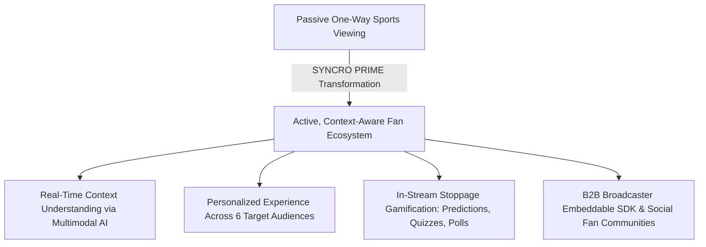
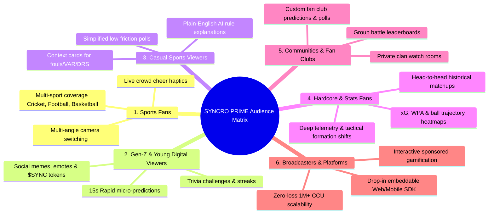
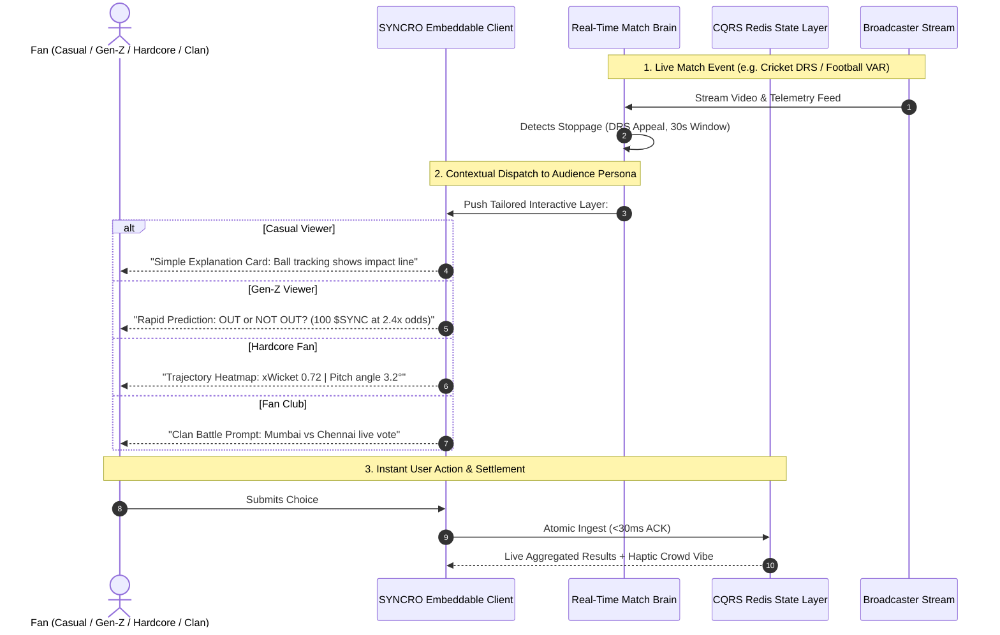
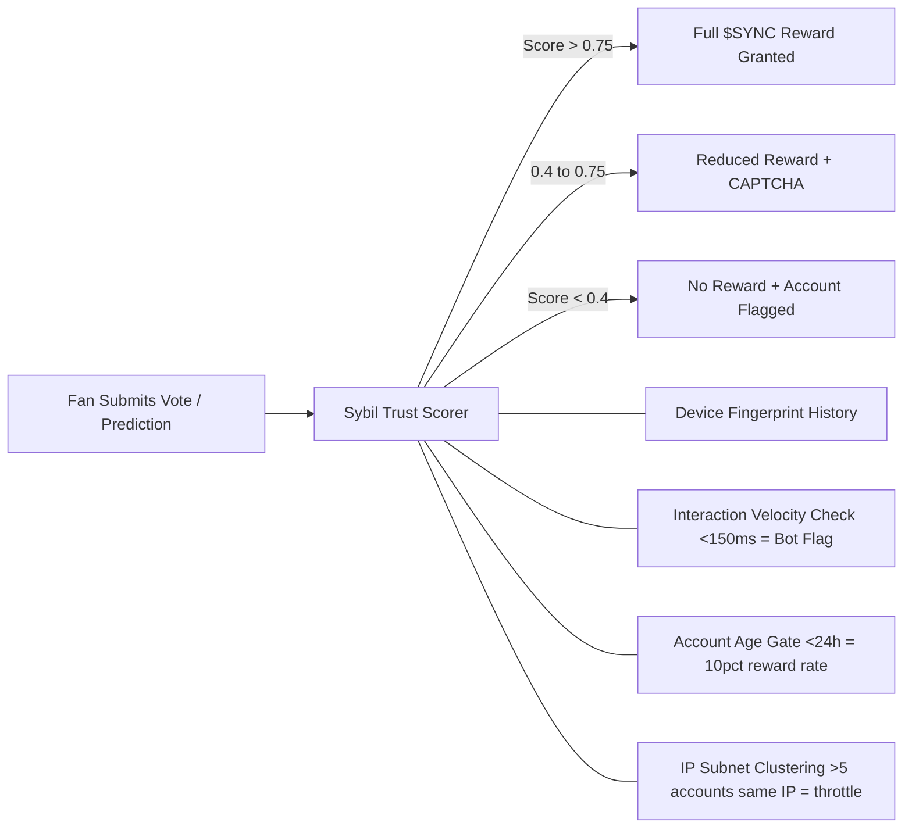
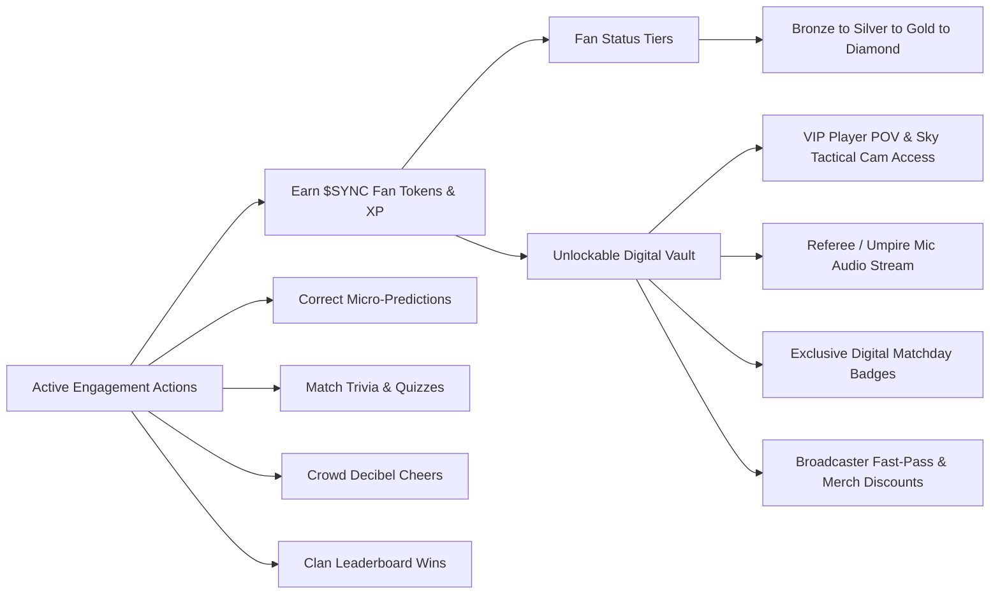
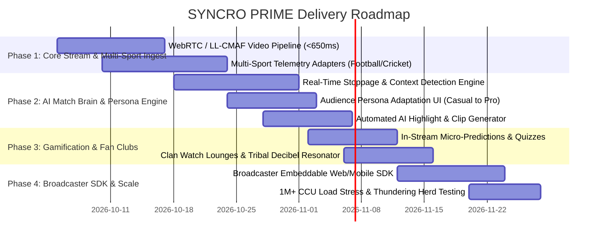

# SYNCRO PRIME: Optimal Solution & Implementation Plan
**AI-Powered Live Sports Fan Companion & Contextual Engagement Ecosystem**
*Wildcard Challenge: Beyond the Obvious — Transforming Sports Viewing into Active, Multi-Audience Participation*

---

## 1. Problem Statement & Solution Vision

### Problem Statement
Live sports viewing is mostly passive, limiting fan participation. Fans need an interactive AI experience that understands live events and turns watching into real-time engagement.

### Proposed Solution
**SYNCRO PRIME** is an AI-powered live match fan companion that continuously analyzes live match context across **Football, Cricket, Basketball, and other sports** to deliver personalized predictions, quizzes, polls, highlights, challenges, and interactive experiences in real time.

---

## 2. Target Audience Segmentation & Tailored Experience Blueprint

The platform explicitly caters to **6 distinct target audience segments**, dynamically adapting its UI density, terminology, and engagement mechanics for each group:

---

### Detailed Persona Solutions

#### 1. Sports Fans (Cricket, Football, Basketball, etc.)
*   **The Need**: Immersive connection beyond standard one-way TV viewing.
*   **The Experience**:
    *   *Multi-Angle Perspective Switcher*: Seamless switching between Main Broadcast, Sky Tactical, Bowler/Player POV, and 360° Fan Endzone.
    *   *Multi-Sport Context*: Automated game clock, strike rates, shot clocks, and live match win-probability graphs.
    *   *Live Crowd Resonator*: Aggregated crowd decibel meter vibrating mobile devices in sync with big stadium moments.

#### 2. Gen-Z & Young Digital Viewers
*   **The Need**: Mobile-first, fast-paced, highly gamified, social interactive experience.
*   **The Experience**:
    *   *15-Second Micro-Challenges*: Rapid prediction popups during live dead times (e.g., "Next ball: 4, 6, Wicket, or Dot?", "Haaland penalty: Left, Right, or Center?").
    *   *Streak Multipliers*: 3-in-a-row correct predictions activate **2x / 3x XP multiplier boosts**.
    *   *Emote Pulses & Fan Badges*: Expressing hype with floating reactive emojis and unlockable profile flair.

#### 3. Casual Sports Viewers
*   **The Need**: Low barrier to entry; elimination of complex, confusing sports rules and acronyms.
*   **The Experience**:
    *   *Plain-English AI Explanations*: One-tap cards explaining obscure referee calls (e.g., "Why was that an offside?", "What is an LBW review?", "Why was that a technical foul?").
    *   *Key-Play Context Summaries*: 1-sentence summaries after key match moments explaining their impact on the game.
    *   *Simplified Polls*: Easy, low-stakes questions (e.g., "Who had the better play this quarter?").

#### 4. Hardcore & Statistics-Oriented Fans
*   **The Need**: Deep analytical depth, real-time telemetry, predictive models, and historical context.
*   **The Experience**:
    *   *Advanced Metric Overlays*: Live Expected Goals (xG), Win Probability Added (WPA), pitch heatmaps, and player speed telemetry (e.g., `34.8 km/h`).
    *   *Historical Head-to-Head Matrices*: Real-time lookup of historical matchup stats (e.g., Kohli vs. Starc strike rates over the last 5 years).
    *   *Interactive Tactical AI Analyst*: Conversational AI deep-dive into pressing formations, defensive line heights, and substitution strategies.

#### 5. Sports Communities & Fan Clubs
*   **The Need**: Shared tribal pride, collective competition, and organized community watch parties.
*   **The Experience**:
    *   *Clan Watch Lounges*: Private audio/chat rooms for official fan clubs (e.g., "Cityzens Global", "Madridistas NY", "Mumbai Paltan").
    *   *Clan War Leaderboards*: Aggregating member prediction points into clan vs. clan competitions.
    *   *Custom Fan Club Polls*: Club moderators can post custom predictions and trivia tailored to their members.

#### 6. Sports Broadcasters & Streaming Platforms
*   **The Need**: Increasing viewer watch time (dwell time), reducing subscriber churn, and monetizing interactive digital real estate.
*   **The Experience**:
    *   *Drop-In Embeddable SDK*: Single-line integration (`<SyncroOverlay matchId="..." />`) into existing OTT apps (Hotstar, ESPN+, DAZN, Peacock).
    *   *Sponsored Interactive Moments*: Branded micro-prediction challenges (e.g., "Nike Speed Prediction: Will this sprint exceed 33 km/h?") that generate direct advertising value.
    *   *Zero-Load Architecture*: CQRS design ensures broadcaster infrastructure is protected from live viewer vote spikes.

---

## 3. End-to-End User Journey & Contextual Interaction Flow

---

## 4. Persona Detection Strategy *(Flaw 2 Fix)*

The Persona Adaptation Engine assigns the correct experience layer through a **three-layer cascade**, not a fixed assumption:

| Layer | Mechanism | When Applied |
|---|---|---|
| **1. Onboarding Quiz** | 3-question preference screen at first launch | New users |
| **2. Behavioral Inference** | XGBoost classifier trained on interaction patterns (stat opens, prediction speed, chat activity) | Every session — continuous update |
| **3. Manual Override** | User can switch persona mode from profile at any time | Always available |

Persona confidence scores (e.g. `0.81 Gen-Z / 0.44 Hardcore`) are stored in the Redis session and refreshed every 5 minutes during a live match.

---

## 5. Fan Economy & Rewards Structure ($SYNC) *(Flaw 5 Fix: Bot Protection)*

The $SYNC economy is protected by a **Sybil Trust Scorer** running on every submission:

Earning Actions and Reward Vault:

---

## 6. Offline & Poor-Connectivity Experience *(Flaw 6 Fix)*

For in-stadium 5G attendees in congested wireless environments:

| Scenario | Behavior |
|---|---|
| **Strong 5G** | Full real-time WebSocket mode — live predictions, leaderboards, cheers. |
| **Degraded signal** | PWA Service Worker activates. Last match state cached. Actions queued in IndexedDB. |
| **Reconnection** | Queued actions synced silently to server. Server deduplicates by `client_event_id`. |

User sees a clear **"Offline Mode — Syncing when back online"** banner. No crashes, no lost votes, no data loss.

---

## 5. Phased Implementation & Delivery Roadmap

---

## Summary of Dual Project Documents

1. **[SYSTEM_ARCHITECTURE.md](file:///c:/Users/rajab/Desktop/fan%20engaement/SYSTEM_ARCHITECTURE.md)**: Technical architecture, multi-sport telemetry pipelines, CQRS state management, and dataset schemas.
2. **[OPTIMAL_SOLUTION_PLAN.md](file:///c:/Users/rajab/Desktop/fan%20engaement/OPTIMAL_SOLUTION_PLAN.md)**: Problem statement, proposed companion solution, 6 audience persona blueprints, gamification mechanics, and execution roadmap.
