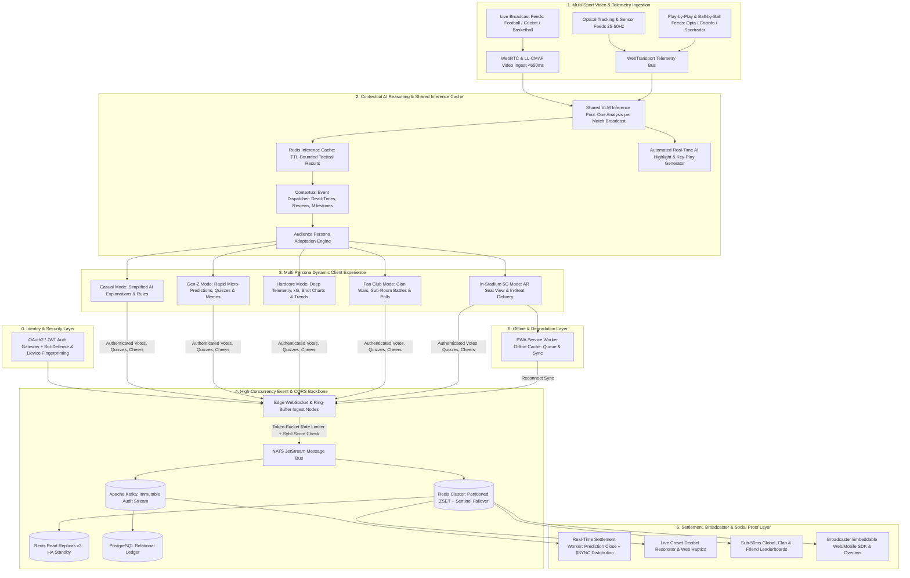
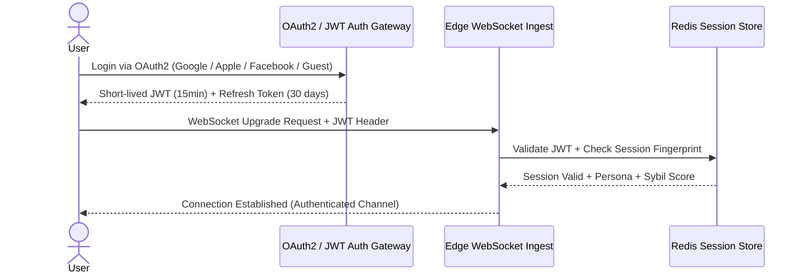
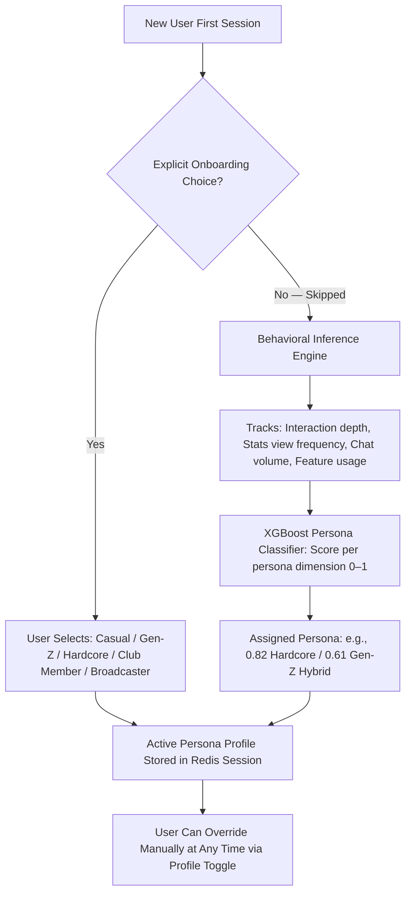
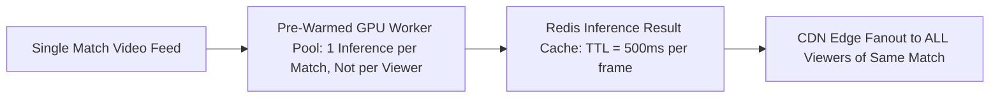
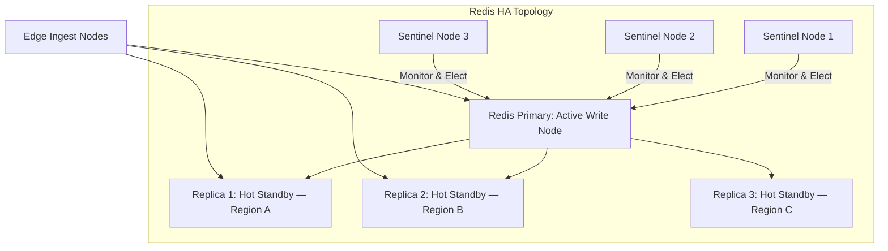
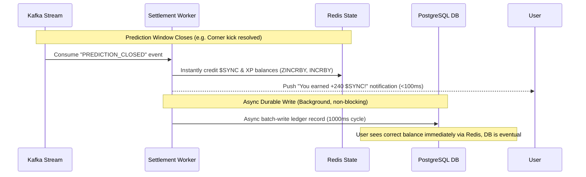
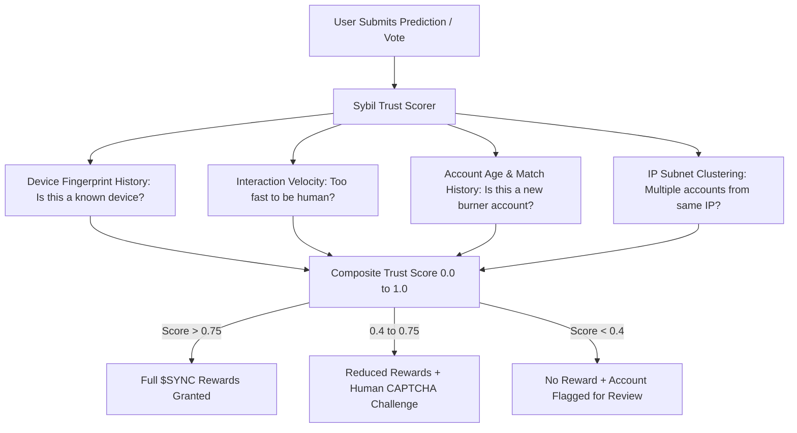
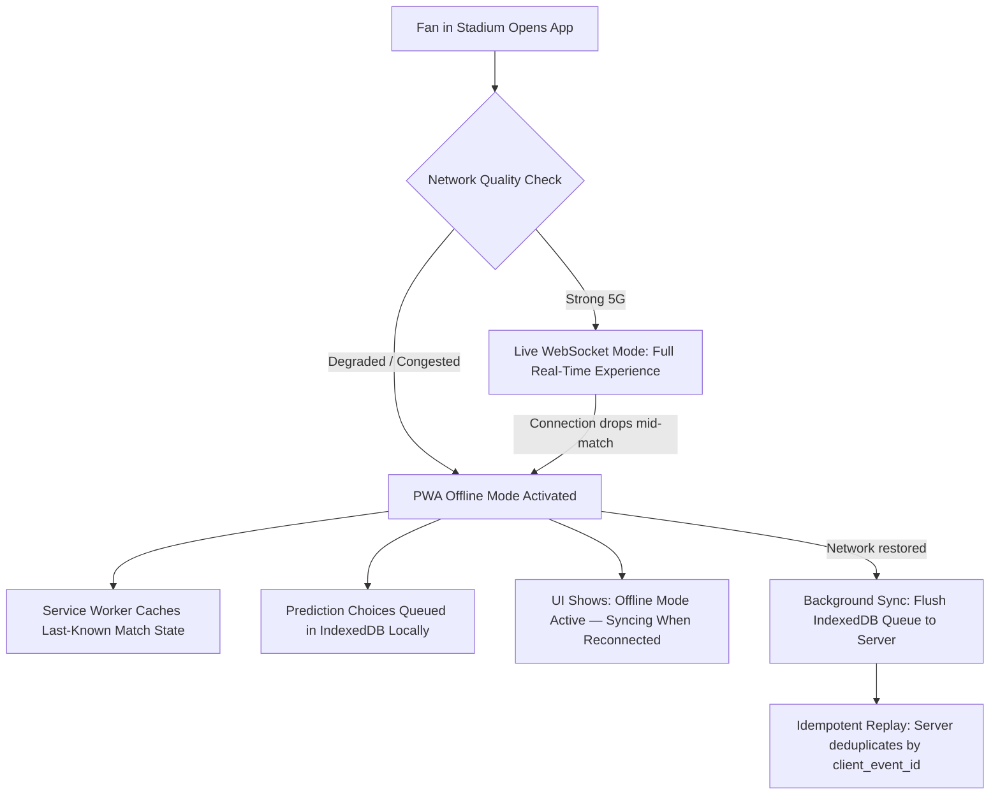
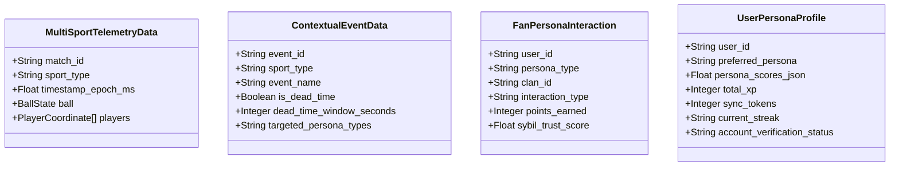

# SYNCRO PRIME: Master System Architecture Specification
**High-Concurrency, Ultra-Low-Latency AI-Powered Sports Fan Companion & Broadcast Ecosystem**
*Wildcard Challenge: Beyond the Obvious — Real-Time Contextual Intelligence & Multi-Audience Personalization*

---

## 1. System Mission & Multi-Sport Domain Topology

**SYNCRO PRIME** is an AI-powered live sports companion and interactive broadcast layer that turns passive viewing into an immersive, active ecosystem across **Football, Cricket, Basketball, and other major sports**. The platform features real-time contextual awareness, personalized interfaces for 6 distinct target audience personas, and B2B SDK embeddability for sports broadcasters.



---

## 2. Core Subsystems & Engineering Architecture

---

### Subsystem 0: Authentication, Authorization & Session Security *(Flaw 1 Fix)*

Every client connection is authenticated before entering any real-time bus. This is the mandatory zero-trust entry gate for the platform.



*   **Protocol**: OAuth 2.0 / OpenID Connect with short-lived JWTs (15-minute expiry) and rolling refresh tokens.
*   **WebSocket Auth**: JWT is passed as a connection header on WebSocket upgrade. Edge nodes validate signature and expiry against a Redis session store — no database hit per message.
*   **Device Fingerprinting**: Every session is bound to a device fingerprint (UA, screen entropy, IP subnet) to detect multi-account switching.
*   **Guest Mode**: Unauthenticated users receive a signed ephemeral guest token enabling read-only access to polls and leaderboards, but cannot earn $SYNC tokens.

---

### Subsystem 1: Persona Detection Engine *(Flaw 2 Fix)*

The persona is not assumed — it is determined through a **three-layer detection cascade**:



*   **Layer 1 — Onboarding Quiz**: A 3-question onboarding screen ("How do you prefer to watch sports?") that immediately assigns an initial persona.
*   **Layer 2 — Behavioral Inference**: A lightweight XGBoost classifier trained on session telemetry (stat overlay opens, prediction speed, chat frequency) updates the persona confidence scores per-session.
*   **Layer 3 — Manual Override**: Users can always switch persona mode manually from the profile drawer without losing XP or token balances.

---

### Subsystem 2: Multi-Sport Telemetry & Video Pipeline

*   **Media Transport**: WebRTC with adaptive LL-CMAF fallback ensuring glass-to-glass latency **$\le 650\text{ ms}$**.
*   **Multi-Sport Ingestion Adapters**:
    *   *Football / Soccer*: Pitch coordinates, player skeletal tracking, ball speed, xG contours.
    *   *Cricket*: Ball-by-ball trajectory, Hawkeye pitch map, bowler release speed, projected runs, DRS review metadata.
    *   *Basketball*: Shot clock countdown, player court positioning, shot arc probability, defensive separation.
*   **Frame-Accurate Metadata Injection**: ID3 / SEI timed metadata tracks injected into video streams ensuring millisecond synchronization between video and contextual overlays.

---

### Subsystem 3: Shared VLM Inference Pool & Inference Cache *(Flaw 4 Fix)*

The critical cost and compute flaw of "one VLM inference per viewer" is eliminated through a **shared match-level broadcast inference model**:



*   **One Analysis Per Match**: The VLM worker processes the **broadcast feed once** and caches tactical results (formations, speed tags, xG values) in Redis with a 500ms TTL.
*   **All viewers of the same match receive the same cached overlay data** — compute cost is $O(1)$ per match, not $O(N)$ per viewer.
*   **Pre-Warmed Worker Pools**: GPU inference workers are pre-warmed 10 minutes before match kickoff to eliminate cold-start latency.
*   **Edge Propagation**: Cached inference results are pushed to CDN edge PoPs closest to viewer clusters, further reducing round-trip time.

---

### Subsystem 4: High-Concurrency Ingestion & CQRS State Engine

*   **Thundering Herd Protection**: Edge ring-buffer token buckets aggregate burst writes during high-intensity events.
*   **CQRS In-Memory Read Path**: Partitioned **Redis Sorted Sets (`ZSET`)** serving **1,000,000+ reads/sec** at sub-5ms response time.

#### Redis High-Availability Configuration *(Flaw 3 Fix)*



*   **Redis Sentinel with 3 Replicas**: One primary write node with 3 cross-region read replicas and a Sentinel quorum of 3 nodes for automatic failover.
*   **Automatic Failover SLA**: If the primary fails, Sentinel promotes a replica within **<5 seconds** — leaderboards and prediction state survive the failover with zero data loss (sync replication).
*   **In-Match State Persistence**: Prediction pool state and leaderboard ZSETs are **AOF (Append-Only File) persisted to disk** every 1 second as an additional safety net.

---

### Subsystem 5: Real-Time Prediction Settlement Engine *(Flaw 7 Fix)*

The 1,000ms Kafka-to-PostgreSQL batch cycle no longer gates $SYNC payouts. Settlement is decoupled into two independent paths:



*   **Immediate UX Settlement via Redis**: The moment a prediction closes, the Settlement Worker credits balances directly in Redis. The user sees their correct $SYNC balance instantly.
*   **PostgreSQL as Eventual Ledger**: The database write is a background durability operation, not a settlement gate. Even if a batch is delayed, the Redis state is the source-of-truth for live sessions.
*   **Settlement Event Idempotency**: Each settlement event carries a unique `settlement_id`. The Settlement Worker checks a Redis bloom filter to reject duplicate processing, preventing double-credit on retries.

---

### Subsystem 6: Broadcaster & Platform B2B Embeddable SDK

*   **SDK**: Lightweight WebComponent / React / React Native SDK (`<SyncroOverlay matchId="..." />`).
*   **Sponsor & Ad Gamification**: Branded interactive prediction moments without obscuring the live action.

---

### Subsystem 7: Bot Prevention & $SYNC Anti-Manipulation *(Flaw 5 Fix)*

The fan token economy is protected by a multi-layer behavioral trust scoring system:



*   **Interaction Velocity Check**: Detecting submissions faster than human reaction time (< 150ms from prompt appearance) flags bot behavior.
*   **IP Subnet Clustering**: More than 5 active accounts from the same `/24` subnet per match triggers automatic shadow-limit mode.
*   **Account Age Gating**: Accounts less than 24 hours old can participate in engagement but earn $SYNC at 10% rate until verified via email/phone.
*   **Proof-of-Watch Challenge**: Randomly requiring a "reaction tap" to a dynamic on-screen element validates human presence without disrupting the experience.

---

### Subsystem 8: Offline / Poor-Connectivity Fallback *(Flaw 6 Fix)*

For in-stadium 5G scenarios where network congestion causes drops:



*   **PWA Service Worker**: Caches match state, active prediction questions, and leaderboard snapshots locally in the browser for 90 seconds of offline tolerance.
*   **IndexedDB Action Queue**: User votes and cheers are stored locally with a client-generated `client_event_id`, then batch-replayed when connectivity restores.
*   **Idempotent Replay Guard**: Server-side bloom filter deduplicates replayed events by `client_event_id`, preventing double-counting of offline-queued actions.
*   **Visual Degradation Indicator**: A clear "Offline Mode — Your actions will sync" banner prevents user confusion without breaking the experience.

---

## 3. Comprehensive Dataset Requirements & Schemas



### Dataset 1: Multi-Sport Optical & Sensor Telemetry Dataset
*   **Source**: Optical multi-camera tracking (Hawk-Eye / TRACAB / Second Spectrum) and player RFID chips.
*   **Sample Rate**: 25 Hz – 50 Hz.
*   **Payload Schema (Multi-Sport Universal Container)**:
    ```json
    {
      "match_id": "IND_AUS_T20_2026",
      "sport": "CRICKET",
      "timestamp_ms": 1775304001200,
      "frame_idx": 84210,
      "ball": {
        "x": 18.2, "y": 1.4, "z": 0.35,
        "speed_kmh": 144.2,
        "trajectory_pitch_point": { "x": 16.8, "y": 0.2 }
      },
      "active_players": [
        {
          "player_id": "ind_18_kohli",
          "role": "BATSMAN",
          "strike_position": "ON_STRIKE",
          "bat_speed_kmh": 118.5,
          "heart_rate_bpm": 152
        },
        {
          "player_id": "aus_56_starc",
          "role": "BOWLER",
          "release_speed_kmh": 144.2,
          "run_up_velocity_ms": 7.4
        }
      ]
    }
    ```

### Dataset 2: Contextual Play-by-Play & Dead-Time Annotation Dataset
*   **Source**: Automated match event feeds (Opta / StatsBomb / Cricinfo) + referee communication sensors.
*   **Payload Schema**:
    ```json
    {
      "event_id": "EVT_DRS_REVIEW_1830",
      "match_id": "IND_AUS_T20_2026",
      "sport": "CRICKET",
      "event_type": "DRS_LBW_REVIEW",
      "is_dead_time": true,
      "estimated_dead_time_seconds": 45,
      "contextual_narrative": "Third umpire reviewing ball tracking for LBW against Kohli.",
      "prompts_generated": {
        "casual": "Will the ball hit the stumps? (Yes / No)",
        "genz": "DRS Verdict: OUT or NOT OUT? 🔥 (100 $SYNC at stake)",
        "hardcore": "Predicted Impact: Line / Outside Off / Umpire's Call (xWicket: 0.72)"
      }
    }
    ```

### Dataset 3: Persona Profile & Gamification Ledger Dataset
*   **Source**: User Session Store & Distributed Ledger.
*   **Payload Schema**:
    ```json
    {
      "user_id": "usr_genz_7721",
      "preferred_persona": "GEN_Z_DIGITAL",
      "persona_confidence_scores": {
        "casual": 0.12, "genz": 0.81,
        "hardcore": 0.44, "club_member": 0.62
      },
      "account_verification": "EMAIL_VERIFIED",
      "sybil_trust_score": 0.94,
      "clan_id": "clan_mumbai_indians_elite",
      "gamification_state": {
        "xp_total": 4850,
        "sync_tokens": 1280,
        "prediction_streak": 5,
        "streak_multiplier": 3.0,
        "tier_badge": "DIAMOND_ANALYST"
      },
      "active_session": {
        "match_id": "IND_AUS_T20_2026",
        "client_platform": "MOBILE_PWA",
        "stadium_location": "SEC_114_ROW_G",
        "offline_queue_depth": 0
      }
    }
    ```

### Dataset 4: Historical Multi-Sport Analytics & Head-to-Head Dataset
*   **Source**: Multi-season historical database (1M+ deliveries, 500k+ football shots, 2M+ basketball possessions).
*   **Fields**: Bowler vs. Batsman head-to-head metrics, penalty conversion probabilities by goalkeeper, 4th-quarter clutch shooting percentages, historical team rivalry metrics.

---

## 4. Non-Functional Requirements & Performance SLAs

| Parameter | SLA Specification | Engineering Mechanism |
| :--- | :--- | :--- |
| **Glass-to-Glass Video Latency** | $\le 650\text{ ms}$ | WebRTC with Anycast global edge routing |
| **Micro-Prediction Acknowledgment** | $\le 30\text{ ms}$ | Distributed Go/Rust edge gateways with ring buffers |
| **Prediction Settlement to User** | $\le 100\text{ ms}$ | Redis-first settlement; DB write is async background |
| **Peak Concurrency Tolerance** | $1,000,000+\text{ CCU}$ | Partitioned Redis `ZSET` + NATS JetStream fanout |
| **Database Lock Contention** | $0\text{ SQL locks}$ | Complete CQRS separation; zero synchronous DB writes during gameplay |
| **Redis Failover Recovery** | $\le 5\text{ seconds}$ | Redis Sentinel 3-node quorum with cross-region read replicas |
| **VLM Inference Cost** | $O(1)\text{ per match}$ | Shared inference pool + Redis TTL cache; not per-viewer |
| **Persona UI Switch Latency** | $<50\text{ ms}$ | Client-side reactive layout engine |
| **AI Context Generation Latency** | $\le 800\text{ ms}$ | Pre-warmed VLM worker pools activated 10 min pre-kickoff |
| **Offline Tolerance (Stadium)** | $90\text{ seconds}$ | PWA Service Worker + IndexedDB action queue |
| **Toxicity Moderation Latency** | $\le 15\text{ ms}$ | Quantized Transformer at CDN edge nodes |
| **Bot Detection Latency** | $\le 20\text{ ms}$ | Composite Sybil scorer pre-computed on session establishment |
